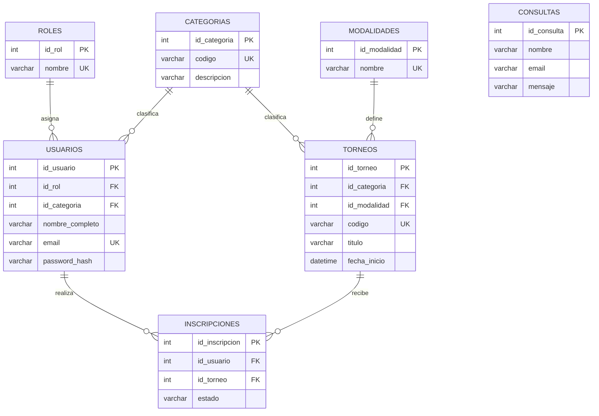

# TP6 — Normalización y diseño de base de datos

**Proyecto integrador:** Padel Tournament Organizer  
**Motor de base de datos:** MySQL / MariaDB (XAMPP, Laragon o phpMyAdmin)  
**Base de datos propuesta:** `padel_tournament_organizer`  
**Objetivo:** diseñar un esquema relacional en tercera forma normal (3FN), preparar el script de creación de tablas y demostrar las operaciones CRUD.

## 1. Descripción y relación con la página web

Padel Tournament Organizer es una página orientada a informar sobre torneos de pádel y permitir que las personas se registren para participar. En los archivos PHP actuales se observan:

- `registro.php`: un formulario que solicita **nombre completo, correo electrónico, teléfono, género, categoría y contraseña**.
- `torneos-de-padel.php`: categorías desde primera hasta octava, filtro por categoría e información sobre torneos masculinos, femeninos y mixtos.
- `contacto.php`: un formulario con **nombre, email y mensaje**.
- `blog.php`, `canchas.php`, `productos.php` y otras páginas: contenido principalmente informativo.

**Alcance del TP6:** se modela la parte principal de gestión de usuarios y torneos, las inscripciones y las consultas de contacto. Las páginas informativas siguen siendo contenido estático; no hace falta crear una tabla por cada archivo PHP. **Las tablas y datos de los scripts son un diseño para implementar:** la aplicación actual todavía no guarda registros o consultas en esta base de datos.

> Los nombres de personas, correos, torneos, fechas y lugares usados a continuación son **ejemplos ficticios**, no datos de usuarios reales ni eventos confirmados.

## Parte 1 — Normalización aplicada al proyecto

### 1.1. Entidad / tabla principal sin normalizar (0FN)

Supongamos una única tabla, llamada `registro_torneos_sin_normalizar`, que guarda los datos del torneo y una **lista de participantes** dentro de una misma fila:

| id_torneo | titulo_torneo | fecha_inicio | categoria / descripción | modalidad | participantes | estados_inscripcion |
|---|---|---|---|---|---|---|
| 10 | Copa Primavera - 4ta | 2026-11-07 10:00 | 4ta / Principiantes e intermedios | Mixto | 1: Lucía Torres (lucia.torres@example.test); 2: Mateo Ríos (mateo.rios@example.test) | Confirmada; Pendiente |

**Problemas:** `participantes` y `estados_inscripcion` contienen listas (valores no atómicos). Además, si se guardaran varios torneos por separado, sus datos de categoría se repetirían. Resultaría difícil consultar un jugador, cambiar su estado de inscripción o evitar inconsistencias entre listas.

### 1.2. Primera forma normal (1FN)

Para cumplir 1FN, cada celda debe contener **un solo valor** y cada inscripción debe ocupar una fila independiente. En este ejemplo, usamos una clave primaria compuesta por `(id_torneo, id_usuario)`:

| id_torneo | id_usuario | titulo_torneo | categoria_codigo | usuario_nombre | usuario_email | estado_inscripcion |
|---|---|---|---|---|---|---|
| 10 | 1 | Copa Primavera - 4ta | 4ta | Lucía Torres | lucia.torres@example.test | confirmada |
| 10 | 2 | Copa Primavera - 4ta | 4ta | Mateo Ríos | mateo.rios@example.test | pendiente |

Además de las columnas mostradas, esta tabla conceptual conserva `fecha_inicio`, `id_categoria`, `descripcion_categoria`, `id_modalidad`, `nombre_modalidad`, `id_rol`, `nombre_rol` y otros datos del usuario.

**Resultado:** no hay listas dentro de una celda y cada fila representa un registro específico. Sin embargo, se repiten datos del torneo y del usuario, por lo que todavía existen dependencias parciales.

### 1.3. Segunda forma normal (2FN)

La clave compuesta del ejemplo es `(id_torneo, id_usuario)`:

- `titulo_torneo`, `fecha_inicio`, `id_categoria` y `nombre_modalidad` dependen **solo de `id_torneo`**.
- `usuario_nombre`, `usuario_email`, `id_rol` y `nombre_rol` dependen **solo de `id_usuario`**.
- `estado_inscripcion` depende de la combinación **(`id_torneo`, `id_usuario`)**.

Para eliminar las dependencias parciales, la tabla se descompone en estas tres estructuras intermedias:

| Tabla en 2FN | Clave | Columnas relevantes |
|---|---|---|
| `usuarios_2fn` | `id_usuario` (PK) | nombre_completo, email, password_hash, teléfono, género, id_rol, nombre_rol, id_categoria_jugador |
| `torneos_2fn` | `id_torneo` (PK) | título, fecha_inicio, id_categoria, categoria_codigo, descripcion_categoria, id_modalidad, nombre_modalidad |
| `inscripciones_2fn` | (`id_usuario`, `id_torneo`) (PK compuesta) | estado_inscripcion |

Ahora los datos personales se almacenan una vez por usuario y los datos de un torneo se almacenan una vez por torneo. **Pero todavía existen dependencias transitivas** dentro de `usuarios_2fn` y `torneos_2fn`.

### 1.4. Tercera forma normal (3FN)

Para alcanzar 3FN, todo atributo no clave debe depender de la clave, de toda la clave y **de ninguna columna no clave**. Por ejemplo:

- En `usuarios_2fn`, `id_usuario → id_rol → nombre_rol`. El nombre del rol depende del identificador de rol, no directamente del usuario. Se extrae la tabla `roles`.
- En `torneos_2fn`, `id_torneo → id_categoria → (codigo, descripcion_categoria)`. La información de la categoría se extrae a `categorias`.
- En `torneos_2fn`, `id_torneo → id_modalidad → nombre_modalidad`. La información de la modalidad se extrae a `modalidades`.

**Resultado definitivo:** `usuarios` solo almacena los identificadores de rol y categoría del jugador; `torneos` almacena los identificadores de categoría y modalidad; `inscripciones` conecta los usuarios con los torneos sin repetir sus datos. La tabla `consultas` conserva los mensajes de visitantes y es independiente de las inscripciones.

El modelo final usa claves primarias numéricas autoincrementales, incluida `inscripciones.id_inscripcion`. Para preservar la regla de que un usuario solo puede inscribirse una vez en el mismo torneo, se agrega la restricción `UNIQUE (id_usuario, id_torneo)`.

### 1.5. Listado de tablas resultantes, PK y FK

| Tabla | Clave primaria (PK) | Claves foráneas (FK) | Función |
|---|---|---|---|
| `roles` | `id_rol` | — | Define Administrador y Jugador. |
| `categorias` | `id_categoria` | — | Define 1ra, 2da, 3ra, 4ta, 5ta, 6ta, 7ma y 8va. |
| `modalidades` | `id_modalidad` | — | Define Masculino, Femenino y Mixto. |
| `usuarios` | `id_usuario` | `id_rol → roles.id_rol`; `id_categoria → categorias.id_categoria` | Datos personales y autenticación. |
| `torneos` | `id_torneo` | `id_categoria → categorias.id_categoria`; `id_modalidad → modalidades.id_modalidad` | Eventos, fechas, cupos y estados. |
| `inscripciones` | `id_inscripcion` | `id_usuario → usuarios.id_usuario`; `id_torneo → torneos.id_torneo` | Relación N:M entre usuarios y torneos. |
| `consultas` | `id_consulta` | — | Consultas de contacto, incluso de visitantes sin cuenta. |

**Relaciones:** un rol puede pertenecer a muchos usuarios (1:N); una categoría puede corresponder a muchos usuarios y a muchos torneos (1:N); una modalidad puede corresponder a muchos torneos (1:N); un usuario puede participar en muchos torneos y un torneo puede tener muchos usuarios (**N:M**, resuelta mediante `inscripciones`).

#### Diagrama entidad–relación (visible en GitHub)



## Parte 2 — Script DDL en MySQL (`schema.sql`)

El archivo `schema.sql` crea la base de datos `padel_tournament_organizer` e incluye las **siete tablas** anteriores. Cumple estos requisitos:

1. `CREATE DATABASE IF NOT EXISTS` y `USE`.
2. `INT AUTO_INCREMENT PRIMARY KEY` en todas las tablas.
3. `FOREIGN KEY ... REFERENCES ...` para mantener la integridad referencial.
4. Campos `created_at` y `updated_at` con sus valores predeterminados y actualización automática en `usuarios`, `torneos`, `inscripciones` y `consultas`.
5. Índice explícito `CREATE INDEX idx_torneos_fecha_inicio ON torneos (fecha_inicio)` para buscar torneos por fecha.
6. `UNIQUE` en los correos de usuarios y los códigos de torneos; otra restricción `UNIQUE` evita duplicar inscripciones.

**Seguridad:** la columna `password_hash` guarda el resultado de `password_hash()` de PHP, no contraseñas sin cifrar. Más adelante, el TP7 podrá verificar la contraseña con `password_verify()` y realizar inserciones usando consultas preparadas con PDO.

## Parte 3 — Consultas de prueba CRUD (`consultas.sql`)

El archivo `consultas.sql` realiza y verifica lo siguiente:

| Operación | Prueba |
|---|---|
| **Create / INSERT** | Agrega dos roles, ocho categorías, tres modalidades, tres usuarios ficticios, dos torneos, tres inscripciones y una consulta temporal. |
| **Read / SELECT** | Filtra torneos por categoría **4ta** y estado `programado`, ordenados por fecha. |
| **Read / INNER JOIN** | Muestra jugador, correo, nombre del torneo, categoría, modalidad y estado de inscripción, enlazando cinco tablas. |
| **Update / UPDATE** | Modifica `cupo_maximo` del torneo identificado por `COPA-PRIMAVERA-4TA-2026`, con `WHERE`. |
| **Delete / DELETE** | Elimina solamente una consulta temporal mediante `WHERE` sobre su correo y mensaje. |

## 4. Cómo probarlo en XAMPP / phpMyAdmin

1. Iniciar **Apache** y **MySQL** desde el panel de control de XAMPP.
2. Abrir `http://localhost/phpmyadmin/`.
3. Entrar en **Importar**, seleccionar **`schema.sql`** y ejecutar.
4. Comprobar que apareció la base **`padel_tournament_organizer`** con sus siete tablas.
5. Volver a **Importar**, seleccionar **`consultas.sql`** y ejecutar.
6. Revisar las respuestas de las sentencias `SELECT`. También se pueden abrir las tablas `usuarios`, `torneos`, `inscripciones` y `consultas` desde el panel lateral.

### Resultados esperados

- **2 torneos** y **3 inscripciones** de prueba.
- Un `SELECT` que muestre los torneos de **4ta** categoría.
- Un `INNER JOIN` que muestre los **3 registros de inscripción** junto con sus jugadores y torneos.
- Después del `UPDATE`, el torneo `COPA-PRIMAVERA-4TA-2026` tendrá `cupo_maximo = 20`.
- Después del `DELETE`, la consulta de comprobación `consultas_temporales_restantes` mostrará **0**.

**Importante:** ejecutá estos scripts en una **base nueva de pruebas** y en ese orden. La primera ejecución de `consultas.sql` está pensada para tablas vacías; repetir las inserciones sobre datos existentes puede causar errores de unicidad. Además, `schema.sql` contiene un `CREATE INDEX` que no debe repetirse si el índice ya existe. Los archivos no eliminan automáticamente información previa.

### Posibles diferencias con la web actual

- En `registro.php` la primera categoría aparece como `1ra`, mientras que en `torneos-de-padel.php` figura `1era`. El diseño normalizado estandariza el código como **`1ra`**. Antes de usar la base desde PHP, hay que unificar esos valores.
- El formulario actual de `registro.php` recoge datos del jugador, **pero no el torneo específico**. En el TP7 será necesario añadir una selección de torneo para insertar registros en `inscripciones`.
- El sitio menciona torneos en parejas; esta versión mínima registra participantes individualmente. Una futura versión puede incorporar `parejas` y los integrantes de cada pareja, sin alterar la idea principal del TP6.
- El formulario de `contacto.php` valida y muestra un mensaje de éxito, pero todavía **no persiste** consultas en MySQL.

## 5. Ubicación de entrega en GitHub

Ubicar los tres archivos en una carpeta `tp6/` en la raíz del repositorio:

```text
proyecto-integrador/
├── ... (archivos actuales del sitio)
└── tp6/
    ├── NORMALIZACION.md
    ├── schema.sql
    └── consultas.sql
```

**Relación con TP7:** este diseño relacional y sus claves foráneas serán la base para conectar los formularios PHP a MySQL mediante PDO y consultas preparadas. En el TP6 únicamente se preparan y prueban la estructura y las operaciones SQL; no se modifica el sitio PHP existente.
